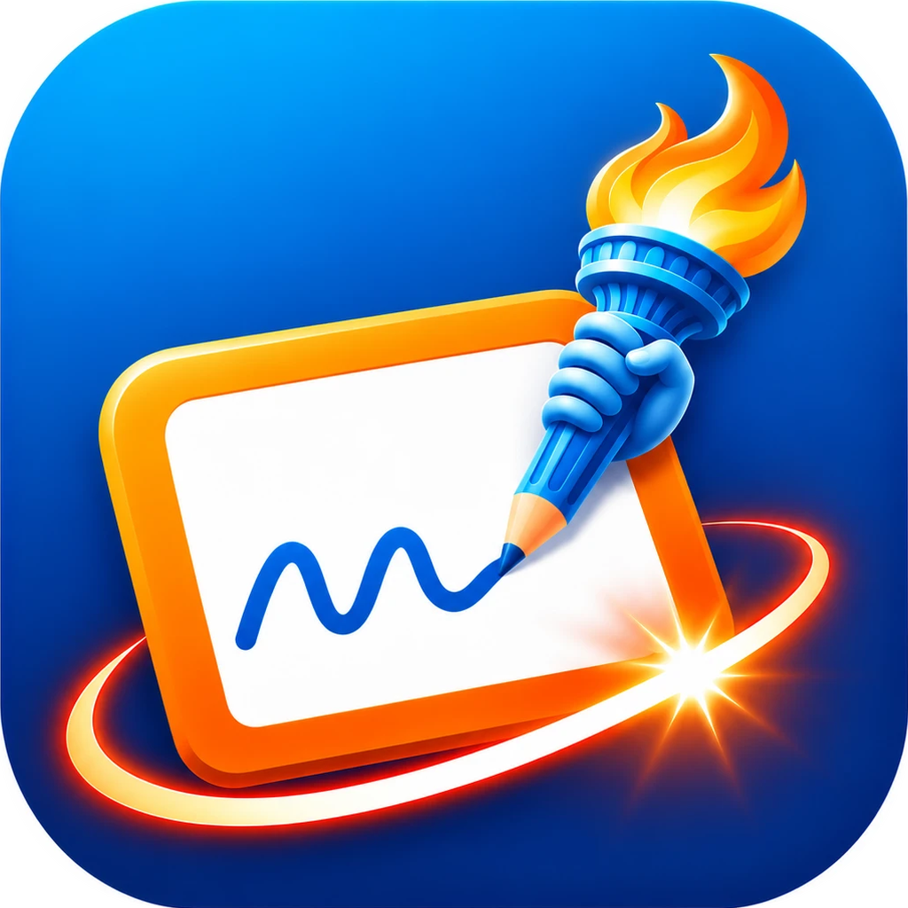
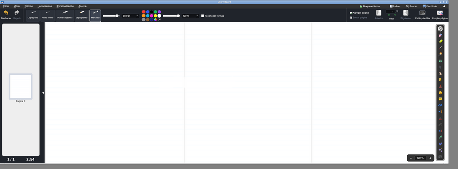

  

<h1 align="center">LibertyBoard</h1>

<b>Pizarra digital y lector de PDF para escribir, dibujar, presentar y estudiar, con inteligencia artificial integrada.</b>

  

LibertyBoard junta en un solo programa lo que antes estaba repartido en muchas herramientas: un lector y anotador de PDF, una pizarra para clases y presentaciones, un modo para escribir sobre cualquier programa abierto y un panel para trabajar con ChatGPT, Claude, Gemini, Copilot y otras IA. Sirve para estudiantes, profesores, trabajadores, creadores de contenido y, en general, para todos los que quieren una herramienta de PDF y pizarra multifuncional.

Lo creó Luis, conocido en YouTube como «Inversor Chileno», tomando como base [OpenBoard](https://github.com/OpenBoard-org/OpenBoard). Luis no programa: construyó LibertyBoard con la ayuda de Claude, una inteligencia artificial, aportando las ideas.

## Descargar

1. Abre la sección **[Releases](https://github.com/inversorchileno/LibertyBoard/releases/latest)** y descarga `LibertyBoard-windows.zip`.
2. Descomprime la carpeta y abre `LibertyBoard.exe`. No necesita instalación.
3. Las versiones siguientes se instalan desde el propio programa: **Acerca → Actualización**.

Cada versión publicada trae sus novedades en su página de Releases. LibertyBoard guarda sus documentos y su configuración en su propia carpeta (`%LOCALAPPDATA%\LibertyBoard`).

## Todas las funciones

### Escribir y dibujar
- **Bolígrafo** con cinco puntas: lápiz pasta, pluma fuente, pluma caligráfica, lápiz grafito y marcador; sensible a la presión del lápiz digital.
- **Colores**: 15 a un clic, rueda para cualquier color y **cuentagotas** para tomar un color de la pantalla; grosor y opacidad.
- **Reconocer formas**: un círculo, rectángulo, triángulo o línea dibujados a mano quedan perfectos.
- **Marcador** de punta circular o recta, como un destacador.
- **Borrador** entero (borra el trazo completo) o parcial.
- **Formas**: 20 formas (línea, polilínea, elipse, rectángulo, triángulos, rombo, flechas de bloque, estrellas, globos de diálogo, nube) con borde, relleno, estilo de línea y opacidad.
- **Flecha** con estilos de línea, puntas y flecha cónica.
- **Texto** con fuente, tamaño, negrita, cursiva y color; casillas para marcar, viñetas, números y **tablas**.
- **Notas** de colores, **notas rápidas**, **sellos** (Aprobado, Confidencial, Borrador… y tu propio PNG), **emojis** y **GIF animados** de klipy.com.
- **Adjuntar archivos**, **hipervínculos** y **sonidos** grabados con tu voz.

### Presentar
- **Puntero láser** con estela que se desvanece, punto o seguimiento del mouse sin clic; efectos estándar, brillo blanco y arcoíris.
- **Foco**, que oscurece todo menos alrededor del puntero, y **lupa**.
- **Pantalla completa** (F11), **doble pizarra** con dos documentos lado a lado y **bloquear lienzo/PDF** para no cambiar nada por error.
- **Leer en voz alta** desde el inicio, desde un texto seleccionado o desde la palabra que tocas, con las voces de Windows; **dictado** de Windows en los cuadros de texto.

### PDF
- Abrir varios PDF en **pestañas** (se reordenan arrastrándolas) y **archivos recientes**.
- **Resaltar** ajustado al tamaño de letra y **subrayar**.
- **Guardar** con las anotaciones dentro del PDF original, **Guardar como** PDF, PNG o JPEG, **Imprimir** con vista previa y **Extraer páginas**.
- **Buscar** con lista de resultados, **Índice** del PDF y enlaces que funcionan; copiar el texto del PDF con la flecha o el lazo.
- **Reconocer texto (OCR)** de un PDF escaneado, para poder buscar y copiar su texto.
- Vista de varias páginas, barra de páginas en el borde derecho, **girar** páginas, **agregar** y **borrar** páginas, zoom con porcentaje editable y pantalla táctil con dos dedos.
- Las notas rápidas y los adjuntos quedan como comentarios y adjuntos dentro del PDF guardado.

### Plantillas
- **Estilo plantilla**: color de la hoja, cuadrícula o líneas y 21 **plantillas** (calendarios diario, semanal, mensual y anual que se arman solos, listas, notas Cornell, pentagrama, papel milimetrado, plan de clase, mapa mental, guion gráfico…), en español, inglés, alemán, francés, chino y japonés.
- Tamaño de página/lienzo personalizado, para seguir dibujando cuando la hoja se llena.

### Inteligencia artificial
- Herramienta **IA** con **Resumen, Traducción, Crear imagen, Quitar fondo, Borrado generativo** y **Transcribir audio**.
- Eliges una parte de la página o todo el PDF; LibertyBoard lo adjunta, escribe la instrucción y la envía.
- La página de la IA se abre al costado, con tu sesión guardada: ChatGPT, Claude, Gemini, Copilot, DeepSeek, Grok, Le Chat y Perplexity, y cualquier otra que agregues en Preferencias.
- El resultado vuelve a la página arrastrándolo, con clic derecho o descargándolo; si se acaban los usos gratis, un aviso ofrece otra IA.

### Modo escritorio
- Escribe, dibuja, señala con el láser y usa la IA encima de cualquier programa abierto.
- La barra queda vertical a los lados o horizontal arriba y abajo, con triángulos de opciones, se achica con un clic y lleva una papelera para borrar todo.
- Borde de color alrededor de la pantalla y captura de pantalla.

### A tu manera
- Menú **Herramientas** con todas las herramientas.
- Menú **Personalización**: elige qué botones se ven en la pizarra y en el escritorio, y su orden con **Mover elementos**.
- **Acerca → Atajos**: todos los atajos de teclado, que se pueden cambiar, con aviso si chocan con Windows o con el programa.
- **Consejos y trucos** (F1): una guía con imágenes de cada herramienta.
- 33 idiomas.

## Compilar desde el código

La versión de Windows se compila automáticamente con GitHub Actions (`.github/workflows/windows-build.yml`) usando Qt 6 y MSVC, y se publica en Releases con las notas de `docs/releases`. Las notas de diseño y lo acordado para cada etapa están en [docs/LIBERTYBOARD.md](docs/LIBERTYBOARD.md).

## Licencia y origen

LibertyBoard es una **versión modificada de [OpenBoard](https://github.com/OpenBoard-org/OpenBoard)**, que a su vez deriva de Open-Sankoré y Uniboard. Se distribuye bajo la **Licencia Pública General de GNU, versión 3 (GPLv3)**, igual que OpenBoard, con la misma excepción de enlace para OpenSSL. Ver [LICENSE](LICENSE) y [COPYRIGHT](COPYRIGHT).

Los avisos de copyright originales se mantienen en los archivos de código. LibertyBoard no está afiliado ni respaldado por el proyecto OpenBoard ni por sus autores.
